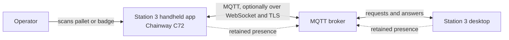

<div align="center">
  
  <h1>PPNAM Station 3 Handheld</h1>
  <p>
    Android app for the Chainway C72 handheld scanner at the PPNAM master batch station.<br>
    An operator signs in, scans a source pallet, and Station 3 selects that pallet as the<br>
    master batch source and shows its product and the kilograms available.
  </p>
</div>

<p align="center">
  
  &nbsp;&nbsp;&nbsp;&nbsp;
  <picture>
    <source media="(prefers-color-scheme: dark)" srcset="docs/assets/systems-one-dark.png">
    
  </picture>
</p>

<p align="center">
  <a href="https://github.com/Systems-One/PPNAM_Station_3_AA/releases/latest">Latest release (APK)</a> ·
  <a href="#documentation">Documentation</a> ·
  <a href="docs/sop/PPNAM_Station_3_Handheld_SOP.pdf">Operator SOP (PDF)</a> ·
  <a href="docs/Station3_MQTT_Contract_v1.md">MQTT contract</a>
</p>

## Contents

- [What it does](#what-it-does)
- [What the system can do](#what-the-system-can-do)
- [How it fits together](#how-it-fits-together)
- [Status](#status)
- [Get started](#get-started)
- [Install or deploy](#install-or-deploy)
- [Documentation](#documentation)
- [Repository layout](#repository-layout)

## What it does

The app has one job: selecting the source pallet that master batch will be drawn from. The
operator scans the pallet's barcode or RFID tag, and the Station 3 desktop looks it up and
answers. The packs themselves are weighed and labelled on the Station 3 desktop, not on the
handheld.

- Sends the scanned pallet barcode or RFID tag to Station 3, which selects it as the source.
- Shows the source's product code and description, the kilograms available, and the pallet and batch.
- Says why when a pallet cannot be used, with a success or fail sound and vibration for every scan.
- Does not weigh, make packs, print labels or deduct stock, and keeps nothing to send later:
  every scan needs Station 3 online.

## What the system can do

### Handheld app

Built, released as v1.0.0, and covered by 137 JVM unit tests for its logic. Screens are checked
by hand on an emulator; the repo has no automated UI tests. The repo holds no record of on-site
acceptance testing.

| Area | Capability |
|---|---|
| Sign in | Username and password, with the username picked from a list Station 3 supplies or typed. The password is never sent: sign-in uses a SCRAM-SHA-256 proof, and the station's signature is verified before a session is accepted. |
| Sign in | RFID badge sign-in by scanning the badge on the Log In screen. |
| Source selection | Scan a pallet barcode or RFID tag, or type the code, to select the source. A 10 second wait for Station 3's answer, then a Retry button. |
| Source selection | Source card with product code, description, kilograms available, pallet and batch. It clears itself after 15 seconds. |
| Source selection | Staff badges are refused on the handheld and never sent as a source. Typed values that are empty, longer than 500 characters or contain control characters are refused. |
| Permissions | The app offers only the workflows Station 3 lists for the signed-in account. A missing or empty list enables nothing. |
| Scan feedback | Success chirp with a short vibration, fail buzz with two vibrations, and no repeat buzz for the same refused value within 1.5 seconds. |
| Connection status | A status pill on every screen separates "broker not connected" from "Station 3 offline". A full-screen warning covers the scan screen while Station 3 is offline. |
| Connection | Reconnects by itself, from every second up to every 30 seconds. Stops retrying when the broker rejects the handheld's broker account. |
| Session | Checks the session with Station 3 every 30 seconds. Signs out after 15 minutes without a touch or scan (adjustable from 0, meaning never, to 1440 minutes). |
| Settings | Diagnostics open to everyone: broker state, Station 3 state, app version and device id. |
| Settings | Broker host, port, WebSocket, TLS, username, password and auto sign-out time behind a supervisor PIN. Five wrong PINs lock the box for 30 seconds, and the lockout survives a restart. |
| Settings | Test & Apply saves the settings and reconnects with them while the operator stays signed in. |
| Security | The broker password is encrypted with an Android Keystore key and is never shown again once saved. |
| Device | A device id derived once on the handheld (`scanner_` plus 12 hex characters) identifies it to Station 3. Every screen is locked to portrait. |

### MQTT messaging

Built and unit-tested on the handheld side. The other end is the Station 3 desktop, which is not
in this repository.

| Area | Capability |
|---|---|
| Topics | Publishes and acts only inside the `PPNAM/station_3` topic tree. Topic segments containing `/`, `+` or `#` are rejected. |
| Presence | Retained `online` and `offline` with a Last Will for the handheld, and tracking of the station's own presence. Repairs a stale `offline` left by a quick restart. |
| Sign-in messages | Schema 4.1 requests: SCRAM start and proof, badge login and logout, each with a 10 second timeout. |
| Workflow messages | `source_scan` answered by `source_context`, and `heartbeat_requested` answered by `heartbeat_result`. Late answers and answers meant for another handheld are ignored. |

### Delivery

Built and in use: the v1.0.0 release was produced by this workflow.

| Area | Capability |
|---|---|
| Release build | Pushing a `v*` tag builds the APK on GitHub Actions and publishes it as a GitHub Release named after the repository. |
| Signing check | The build fails if the APK is not signed with the expected shared certificate, so a release cannot break updates on handhelds that already have the app. |
| Manual build | Running the workflow by hand builds the APK as a downloadable artifact without making a release. |
| Operator SOP | A script in the repo generates the operator SOP as one self-contained HTML file and an A4 PDF from a Markdown source. |

## How it fits together



| Part | What it does | Folder |
|---|---|---|
| Handheld app | Sign-in, source scan, status, settings and scan feedback on the Chainway C72 | [`app/src/main`](app/src/main) |
| Unit tests | JVM tests for the app's logic (18 test classes, 137 tests) | [`app/src/test`](app/src/test) |
| Release workflow | Builds, checks the signature and publishes the APK | [`.github/workflows`](.github/workflows) |
| Operator SOP | SOP source, screenshots, generator and the generated HTML and PDF | [`docs/sop`](docs/sop) |
| MQTT broker | Carries every message between the handheld and Station 3 | Not in this repository |
| Station 3 desktop | Checks sign-ins, looks up the scanned pallet and answers | Not in this repository |

## Status

| Part | State |
|---|---|
| Handheld app | Version 1.0.0 (version code 9), released 2026-11-26 as `PPNAM_Station_3_AA.apk`. |
| Unit tests | 137 tests in 18 classes, all passing when run on 2026-11-27 with `:app:testDebugUnitTest`. |
| UI tests | None. The repo has no instrumented or automated UI tests; screens are checked by hand on an emulator. |
| Continuous integration | One workflow, which builds and releases the APK. It does not run the unit tests. |
| Operator SOP | Written for app version 1.5.0 and dated 2026-11-06. The app's version number has since been reset to 1.0.0, so the version printed in the SOP no longer matches the release. Its screenshots were taken against a mock of Station 3 with demo data. |
| MQTT contract document | Out of date. It was last updated on 2026-09-10 and says no workflow exists and nothing answers the handheld. The app now implements the source scan and heartbeat messages. Its sections on topics, device identity, presence and sign-in still describe the code. |
| Known gaps | The contract document lists three rules of the fleet MQTT standard that the app does not implement in full: rejecting duplicate property names, rejecting plain-text password fields before dispatch, and recursive redaction of secrets in diagnostic output. |
| On-site testing | No record in this repo. |

## Get started

You need:

- The Android SDK with platform 35, with its location in a `local.properties` file at the repo root (`sdk.dir=...`). That file is not tracked.
- A JDK. `gradle.properties` pins `org.gradle.java.home` to a JDK 21 folder under `C:\Program Files\Android\openjdk`. If your JDK is elsewhere, pass `-Dorg.gradle.java.home=<path>` as the release workflow does (it builds with JDK 17).
- The Gradle wrapper in the repo downloads Gradle 8.14.5 by itself.

From the repo root on Windows:

```powershell
.\gradlew.bat :app:testDebugUnitTest
.\gradlew.bat :app:assembleDebug
```

The unit tests run on the PC and need no handheld, broker or station. The APK is written to
`app\build\outputs\apk\debug\app-debug.apk`.

> [!WARNING]
> A new install defaults to the broker host `mqtt.sysone.co.za` on port 443. Once a broker
> account is saved in Settings the app connects to it and publishes on `PPNAM/station_3`, where
> the Station 3 desktop will act on its scans. Point a development build at a test broker unless
> you mean to talk to the real station.

> [!WARNING]
> An APK built on your PC is signed with your own debug key, not the shared one the release
> workflow uses. It will not install over the released app on a handheld. Releases for handhelds
> come from the workflow.

To cut a release, raise `versionCode` and `versionName` in [`app/build.gradle.kts`](app/build.gradle.kts),
then push a tag that starts with `v`. The [release workflow](.github/workflows/release.yml) does the rest.

## Install or deploy

1. Download `PPNAM_Station_3_AA.apk` from the [latest release](https://github.com/Systems-One/PPNAM_Station_3_AA/releases/latest).
2. Install the APK on the Chainway C72 handheld (Android 8.0 or later).
3. Open **Station 3**. On a new handheld the status pill shows **Offline** until a broker account is saved.
4. A supervisor taps the gear, unlocks Settings with the supervisor PIN, enters the broker host, port, username and password, and taps **Test & Apply**.
5. Wait for the pill to show **Connected**, then sign in with a Station 3 username and password or an RFID badge.

The [operator SOP](docs/sop/PPNAM_Station_3_Handheld_SOP.pdf) covers daily use from there.

## Documentation

| I want to | Read |
|---|---|
| Use the app as an operator or supervisor (print version) | [docs/sop/PPNAM_Station_3_Handheld_SOP.pdf](docs/sop/PPNAM_Station_3_Handheld_SOP.pdf) |
| Read the same SOP on screen | [docs/sop/PPNAM_Station_3_Handheld_SOP.html](docs/sop/PPNAM_Station_3_Handheld_SOP.html) (download and open in a browser) |
| Look up an on-screen message and what to do about it | [docs/sop/content.md](docs/sop/content.md), section "Messages and what to do" |
| Edit the SOP text | [docs/sop/content.md](docs/sop/content.md) |
| Rebuild the SOP HTML and PDF | [docs/sop/_template/README.md](docs/sop/_template/README.md) |
| See the screenshots the SOP uses | [docs/sop/images](docs/sop/images) |
| Understand the MQTT topics, presence, device id and sign-in messages | [docs/Station3_MQTT_Contract_v1.md](docs/Station3_MQTT_Contract_v1.md) (its workflow section is out of date, see [Status](#status)) |
| See the source scan and heartbeat messages as the app implements them | [WorkflowProtocol.kt](app/src/main/java/com/mitas/ppnam/station3aa/WorkflowProtocol.kt) |
| See how a release is built and signed | [.github/workflows/release.yml](.github/workflows/release.yml) |
| Read the plan behind the October 2026 UI audit fixes | [docs/superpowers/plans/2026-10-02-ui-audit-fixes.md](docs/superpowers/plans/2026-10-02-ui-audit-fixes.md) |

## Repository layout

| Folder or file | What is in it |
|---|---|
| [`app`](app) | The Android app module: Kotlin source, layouts, sounds, icons and the unit tests |
| [`docs`](docs) | The MQTT contract, the operator SOP with its generator, the UI audit plan and the README logos |
| [`.github`](.github) | The release workflow |
| [`gradle`](gradle) | The Gradle wrapper and the dependency version catalogue ([`libs.versions.toml`](gradle/libs.versions.toml)) |
| [`build.gradle.kts`](build.gradle.kts), [`settings.gradle.kts`](settings.gradle.kts), [`gradle.properties`](gradle.properties) | The Gradle build setup for the single `app` module |
| [`gradlew`](gradlew), [`gradlew.bat`](gradlew.bat) | The Gradle wrapper scripts |
